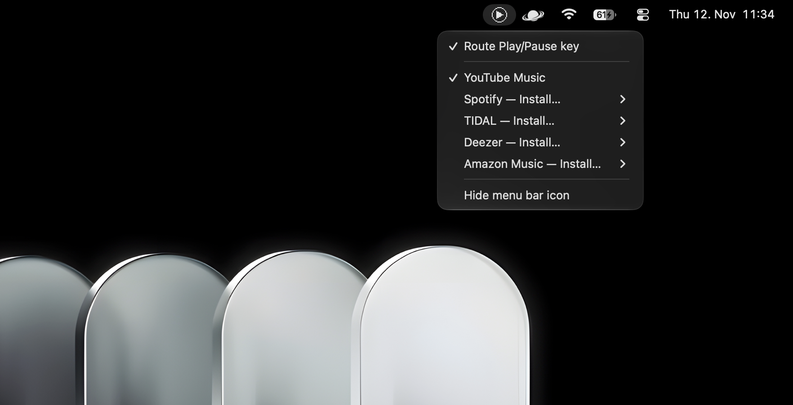

# PlayPause

Make the Mac **Play/Pause** key open the music app you actually use (YouTube Music, Spotify, TIDAL, Deezer, Amazon Music) instead of Apple Music.



## What it does

| When you press Play/Pause | What happens |
| --- | --- |
| Something is already in macOS *Now Playing* (a video, a podcast, your music), playing or paused | Same as always: it plays or pauses it |
| Nothing is in *Now Playing* | Your chosen player opens and starts playing, instead of Apple Music |
| PlayPause is switched off | Normal macOS behavior |

## Install

1. Open the **Terminal** app (press ⌘ Space, type `Terminal`, press Enter).
2. Paste this line and press Enter:

   ```sh
   curl -fsSL https://raw.githubusercontent.com/urbaneeex/playpause-apple/main/install.sh | bash
   ```

3. If it asks for your Mac password, type it and press Enter (nothing shows while you type). This only happens when [Homebrew](https://brew.sh) has to be installed first.
4. A System Settings window opens. Turn on **Hammerspoon** under **Accessibility**. This lets it see the Play/Pause key.
5. Back in Terminal, run:

   ```sh
   open -a Hammerspoon
   ```

Done. A play icon appears in the menu bar.

The installer sets up everything PlayPause needs: Homebrew (if missing), [Hammerspoon](https://www.hammerspoon.org), `nowplaying-cli` and the PlayPause extension. To update later, run the same line again.

## Use

Click the play icon in the menu bar.

### Turn it on or off

Click **Route Play/Pause key**. When it is off, the icon is dimmed and the key behaves like a normal Mac.

| On | Off |
| --- | --- |
|  |  |

### Choose your player

Click a player in the list. The one with the check mark is the one the key opens. Switch to another at any time the same way.

### Install a player you do not have

A player that is not on your Mac shows **Install…**. Open it and pick an option:

- **Download the Mac app**: opens the official download page.
- **Install as a web app (Chrome)**: opens the web player in Chrome. Then, in Chrome, click **⋮** → **Cast, save and share** → **Install page as app**.

YouTube Music has no Mac app, so it is always installed as a web app.

Once installed, the player becomes selectable in the list.

### Hide the icon

Click **Hide menu bar icon**. The key keeps working. To bring the icon back, run this in Terminal:

```sh
open hammerspoon://playpause-show-icon
```

## Troubleshooting

- **Nothing happens when I press the key**: check that Hammerspoon is turned on in System Settings → Privacy & Security → Accessibility, and that **Route Play/Pause key** is ticked.
- **Apple Music still opens**: Hammerspoon is not running. Run `open -a Hammerspoon`.
- **It takes a few seconds to start**: the player was closed, so it has to open and load first. It is immediate while the player is open.
- **"install nowplaying-cli" message**: run the install line again.

## Uninstall

```sh
curl -fsSL https://raw.githubusercontent.com/urbaneeex/playpause-apple/main/uninstall.sh | bash
```

The Play/Pause key goes back to the macOS default.

## For developers

PlayPause is a Hammerspoon Spoon. Manual install:

```sh
brew install --cask hammerspoon
brew install nowplaying-cli
git clone https://github.com/urbaneeex/playpause-apple.git
mkdir -p ~/.hammerspoon/Spoons
ln -s "$PWD/playpause-apple/PlayPause.spoon" ~/.hammerspoon/Spoons/PlayPause.spoon
```

Add to `~/.hammerspoon/init.lua`:

```lua
hs.loadSpoon("PlayPause")
spoon.PlayPause:start()
```

To add your own player, insert it before `start()`. `app` is the app name without `.app`; `toggle` is `"space"` (sends the space bar to the app) or a function:

```lua
hs.loadSpoon("PlayPause")
table.insert(spoon.PlayPause.players, {
  id = "vlc", title = "VLC", app = "VLC", toggle = "space",
})
spoon.PlayPause:start()
```

## License

MIT, see [LICENSE](LICENSE).
